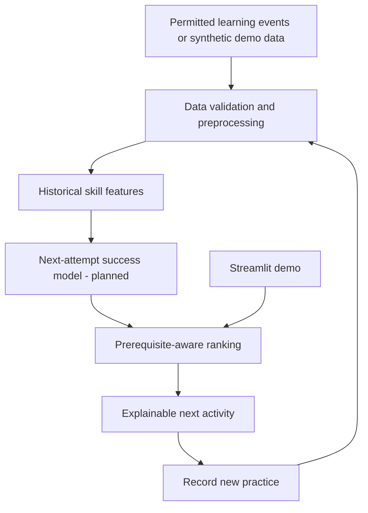

# LearnAdapt AI

**Team:** ERROR-404  
**Challenge:** Challenge 12 — LearnAdapt AI: Personalized Learning Path Prediction  
**Track:** Track 01 — AI Innovation Hackathon 2026

**Team members**
- Mohammad Laeeque Anwar
- Hamna Rehan
- Tara V.
- Mehak Shah

## Project overview

LearnAdapt AI is an explainable adaptive learning-path concept that recommends a suitable next learning activity based on a learner's recent practice, estimated skill readiness, and prerequisite requirements. Instead of assuming that every learner should follow the same sequence, it aims to provide actionable next steps and update recommendations when new practice evidence is recorded.

> **Current repository status:** This repository package provides a runnable Streamlit demonstration using clearly labelled synthetic example data and transparent rule-based recommendation logic. It does not claim to contain a trained predictive ML model or validated educational outcomes. Model training and empirical evaluation remain future implementation tasks unless genuine data, code, and results are added by the team.

## Problem description

A fixed learning sequence can be too easy for one learner and too difficult for another. Learners may need different practice activities depending on their demonstrated readiness and prerequisite knowledge. LearnAdapt AI explores how learning evidence can be turned into a transparent next-step recommendation.

## Proposed solution

The proposed full system follows this pipeline:

1. Observe recent skill-tagged attempts.
2. Extract historical performance features.
3. Estimate the likelihood of success on a subsequent attempt.
4. Check prerequisite constraints.
5. Rank appropriate learning activities.
6. Explain why an activity is recommended.
7. Refresh recommendations when new practice is recorded.

The included demo implements a simplified, rule-based version of the recommendation flow so the concept can be explored without misrepresenting a model as trained.

## Key features

### Included in this demo
- Synthetic sample learner profiles.
- Illustrative skill-readiness values.
- Prerequisite-aware activity filtering.
- Human-readable recommendation reasons.
- A practice-entry interaction that updates the demonstration profile.
- Streamlit interface.

### Planned / not yet validated
- Training and evaluating a next-attempt prediction model.
- Integration with a verified, permitted learning-event dataset.
- Model calibration and uncertainty estimates.
- Offline recommendation evaluation and educator pilot.
- Validation of educational impact with real users.

## Technology stack

- Python
- Streamlit
- pandas

The dependency list is in `requirements.txt`. The current demo uses transparent rules and does not require a trained model artifact.

## Methodology

### Demonstration logic
The app uses synthetic skill-readiness values and a small illustrative prerequisite map. It prioritizes practice for a skill with lower readiness and prevents activities from being recommended before required foundations are sufficiently ready. This logic is intended to demonstrate the product concept, not to represent validated predictions.

### Planned ML methodology
The intended ML approach is to create historical features such as prior skill accuracy, attempt count, recent streaks, and recency, then predict success on a subsequent attempt. Logistic regression and a tree-based classifier are candidates for evaluation; the final choice must be based on experiments.

A recommendation ranker would combine prediction outputs with prerequisite constraints and relevant skill gaps. Predictions and recommendations should be explainable, and low-confidence cases should be handled cautiously.

## Architecture / workflow



The current app demonstrates the UI and simplified recommendation logic. The predictive model stage is planned and must not be treated as implemented.

## Installation

### Requirements
- Python 3.10 or newer recommended
- pip

### Windows PowerShell
```powershell
cd learnadapt-ai
py -m venv .venv
.\.venv\Scripts\Activate.ps1
python -m pip install --upgrade pip
pip install -r requirements.txt
streamlit run app.py
```

If PowerShell blocks activation, run the app with the virtual environment's executable directly:
```powershell
.\.venv\Scripts\python.exe -m pip install -r requirements.txt
.\.venv\Scripts\python.exe -m streamlit run app.py
```

### macOS / Linux
```bash
cd learnadapt-ai
python3 -m venv .venv
source .venv/bin/activate
python -m pip install --upgrade pip
pip install -r requirements.txt
streamlit run app.py
```

## Usage

1. Launch the app with `streamlit run app.py`.
2. Select one of the synthetic learner profiles.
3. Review illustrative skill readiness and the recommended next activity.
4. Record a practice result using the controls in the app.
5. Observe how the demonstration recommendation changes.

All displayed learner records and readiness values are synthetic examples, not real student records or model predictions.

## Dataset information

No external dataset is bundled in this starter repository. The app uses synthetic demonstration data created in code. Before adding a real dataset, document its exact name, source URL, license/terms, relevant fields, preprocessing, and permitted use. Do not upload personal or identifiable student information.

The presentation mentions ASSISTments as a possible data source, but final dataset selection, licensing, and implementation are not confirmed by the supplied presentation alone. Verify the source terms before using it.

## Models used

**Current demo:** No trained ML model is included. Recommendation selection is rule-based and illustrative.

**Planned:** Evaluate a logistic regression classifier against a suitable tree-based model for predicting next-attempt success, using only information available before the target attempt. Choose a final model only after experiments.

## Results

**Predictive model evaluation: pending.** This repository does not report ROC-AUC, Brier score, Recall@3, or other benchmark values because no validated experiment results are included.

When evaluation is implemented, document:
- Dataset and number of usable examples.
- Target definition and class distribution.
- Chronological train/validation/test split.
- Baseline comparison.
- ROC-AUC and Brier score where appropriate.
- Recall@3 and recommendation coverage.
- Cold-start results and limitations.

Offline recommendation relevance is not proof of improved learning outcomes.

## Screenshots and demo

See the `screenshots/` directory. Add genuine screenshots captured from the running application before final submission. Do not describe conceptual mockups as screenshots of a working application.

Local demo: run `streamlit run app.py` using the instructions above.

No hosted demo or public repository URL is claimed in this README. Add verified links after publishing/deployment.

## Limitations

- The included profiles and readiness values are synthetic.
- The current recommendation logic is a simplified demonstration, not a validated ML system.
- No real-world educational outcomes have been established.
- A learner's performance can be affected by factors not represented in the demo.
- Prerequisite thresholds and recommendations need evaluation with educators and suitable data.
- Dataset licensing, fairness, privacy, calibration, and performance must be assessed before real deployment.

## Future scope

- Integrate a verified and permitted learning-event dataset.
- Implement leakage-safe feature engineering and model training.
- Compare against simple baselines with chronological evaluation.
- Add calibrated uncertainty and cold-start handling.
- Expand prerequisite graphs and activity metadata.
- Add educator review and override capabilities.
- Conduct a controlled study before making claims about learning outcomes.

## Credits and attributions

- Team ERROR-404: Mohammad Laeeque Anwar, Hamna Rehan, Tara V., and Mehak Shah.
- Streamlit documentation: https://docs.streamlit.io/
- pandas documentation: https://pandas.pydata.org/docs/

Add credits for any additional dataset, library, icon, visual asset, or external resource actually used. Review each resource's license and attribution requirements.

## Team / contribution notes

Update this section with each member's actual contribution before submission. Do not assign work retrospectively unless it reflects what each person did.

## License

No license has been selected. Add a `LICENSE` file only after the team decides how it wants the source code to be licensed.
